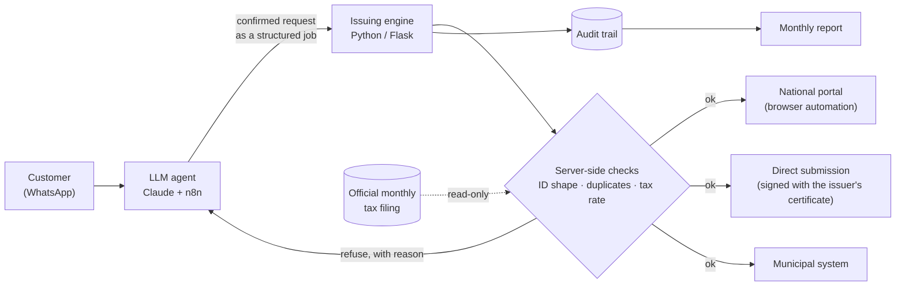

# An AI agent that issues tax invoices, and what I learned measuring where it fails

**Pablo Correia** · AI Automation Engineer · October 2026

> A case study of an LLM agent in production since May 2026. The production code is private: it belongs to a live client operation. This page describes the design and the failures that taught me the most.

## The problem

In Brazil, every service sold needs a municipal service invoice (NFS-e). Issuing one means logging into a government system and filling a long form with tax codes and rates. The system rejects small mistakes. Some mistakes it does *not* reject, and those surface months later.

My client handles invoicing for a portfolio of small businesses. Their customers asked for invoices by message, at any hour, and a person typed each one into the portal.

## What I built

- **A conversational agent on WhatsApp** takes the request in plain language, confirms the details with the customer, and hands a structured job to an issuing engine.
- **The engine, not the model, decides.** It validates the job, checks for duplicates, and issues through one of three routes, depending on the issuer:
  - the national portal, through browser automation;
  - direct submission, signed with the issuer's digital certificate;
  - a municipal system, for a city that is not on the national platform yet.
- **Every action leaves an audit trail**, which is also where the monthly report comes from.
- **Stack:** Python, Flask, n8n, Anthropic Claude API, Chatwoot, on a self-hosted Linux server.
- **In production since May 2026.** I built it, I run it, and I sold it.

## The design rule

**The model talks; the server decides.** My rule is that anything touching money, tax or identity is checked on the server, against a source that is not the conversation. Each time I find a value that still comes from somewhere softer, I move it.

For example, the tax rate on an invoice comes from the issuer's official monthly tax filing, read with a read-only credential. It does not come from the model, and it does not come from a hand-kept spreadsheet.

## Two failures worth telling

### 1. The fix that would have opened another door

In July 2026, Brazil started issuing company tax IDs that contain **letters** as well as digits. My code had the old digits-only rule in **four separate places**. Three only read data. The fourth chose **which digital certificate signs the invoice**.

That fourth copy stripped everything except digits. With the new format, different IDs would collapse into the same key, so an invoice could be routed to sign with **another company's certificate**.

Swapping in a letter-aware normalizer was not enough. It keeps letters, so a company *name* of 16 characters, with spaces removed, came out at 14. Fourteen is exactly the length of a tax ID, so **a name passed the length check as an ID**. The real fix was to validate the **shape** (pattern and check digits), not the length.

Before shipping, I ran the old and the new rule side by side against every historical document, every registry record and every certificate in the vault. **Zero verdicts changed.** No new-format ID had arrived yet, so this was fixed while it was still dormant.

> What I ask now when a rule changes: *How many local copies of the old rule exist?* And: *Does this fix close one door and open another?*

### 2. "Nothing failed" is not "it worked"

A lookup for the tax rate asked a spreadsheet for a tab that did not exist. The code had a safe default, so **nothing raised an error**. The logs looked healthy. The truth was **12 requests and 0 answers**.

Only counting what went **in** against what came **out** showed it. The fix was to move the source to the official tax filing, add a freshness check, and refuse to issue when there is no rate, instead of falling back to a default.

> A well-built fail-safe hides the defect. For every fallback, I now ask: *If this branch never answered, where would I notice?*

## What I measure first

The first thing I measure in any operation is **the difference between what the system says it did and what has confirmation**. Most of the failures above were invisible until I counted both sides.

## Working together

I take on **remote contract engagements** through my company, CLER Automatiza: putting LLM automation into real business operations, with full overlap with US Eastern hours.

[LinkedIn](https://www.linkedin.com/in/pablocorreia0985)
